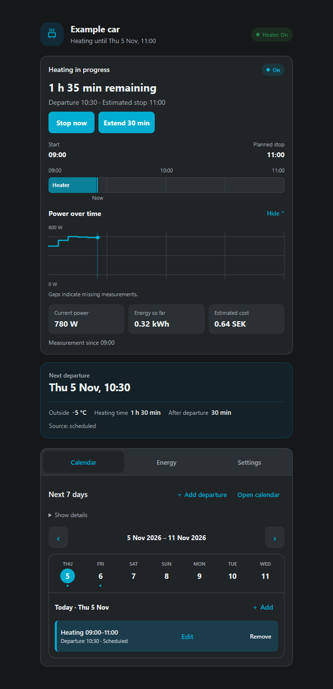

# Engine Heater for Home Assistant

English · [Svenska](docs/README.sv.md)

<!-- ha-marketplace:exclude-start -->
[](https://my.home-assistant.io/redirect/marketplace_repository/?owner=DanneG&repository=ha-motorvarmare&category=integration)
[](https://github.com/hacs/default)
[](https://github.com/DanneG/ha-motorvarmare/releases/latest)
[](https://github.com/DanneG/ha-motorvarmare/actions/workflows/validate.yml)
[](https://github.com/DanneG/ha-motorvarmare/commits/main/)
[](https://github.com/DanneG/ha-motorvarmare/blob/main/LICENSE)
<!-- ha-marketplace:exclude-end -->

Schedule an electric engine heater using the outdoor temperature and a departure time. Each car has its own Home Assistant-compatible smart plug or switch and departure schedule. Configuration, entities and the companion dashboard card support English and Swedish.



## Installation

<!-- ha-marketplace:exclude-start -->
In Home Assistant 2026.11 or later, open **Settings → Marketplace**, search for **Motorvärmare**, and install the integration. On earlier Home Assistant versions, search for it in **HACS** instead.

[](https://my.home-assistant.io/redirect/marketplace_repository/?owner=DanneG&repository=ha-motorvarmare&category=integration)

The Marketplace button requires Home Assistant 2026.11 or later. For earlier versions, use the [HACS repository link](https://my.home-assistant.io/redirect/hacs_repository/?owner=DanneG&repository=ha-motorvarmare&category=integration).

If the integration is not yet available in your catalog, add `https://github.com/DanneG/ha-motorvarmare` as a custom repository in Marketplace or HACS with category **Integration**, then install it.
<!-- ha-marketplace:exclude-end -->

Restart Home Assistant after installation or updating. Under **Settings → Devices & services**, add **Motorvärmare** once for each car. Select the car's switch and an outdoor temperature sensor in °C or °F. A Google calendar is optional.

The dashboard card is included with the integration. When dashboard resources are managed by Home Assistant, the integration registers the card automatically during setup. After the integration is configured, reload your browser or Home Assistant app, add **Motorvärmare** to a dashboard, and select the car's status entity. Add one card per car, or use **Motorvärmare – översikt** to show several cars together.

If dashboard resources are configured in YAML, add this resource to your existing `lovelace.resources` list instead and replace the version value when you update the integration:

```yaml
lovelace:
  resource_mode: yaml
  resources:
    - url: /motorvarmare/ha-motorvarmare-card.js?v=YOUR_INTEGRATION_VERSION
      type: module
```

For example, replace `YOUR_INTEGRATION_VERSION` with the installed integration version. If you already use YAML resources, add this item to the existing `lovelace.resources` list and keep all your other resources. Do not switch an existing installation from storage to YAML just to add this card; the integration handles registration in storage mode.

For a manual installation, copy the entire `custom_components/motorvarmare` directory into Home Assistant's `custom_components` directory, including `translations`, `brand` and `www`, and restart Home Assistant.

### Upgrading from the separate card

The card is now included in the integration; a separate card installation is no longer required. After updating and restarting Home Assistant, reload the browser or app and check that your existing cards load correctly. Your card configuration and car settings should not need to be recreated.

For resources managed by Home Assistant, the integration migrates recognized older resources automatically, including the separate HACS card and the previous `/local/ha-motorvarmare-card.js` manual installation. Once the integrated card works, the separate card package can be removed from HACS. Do not remove the new integrated resource.

For resources configured in YAML, replace the old card's resource URL with the integrated URL shown above and restart Home Assistant. Keep only one Motorvärmare card resource: loading the old and new JavaScript together can cause the older card to be used. If you used a different custom URL, remove that old resource manually, reload the browser and check that the integrated card loads.

For a dashboard with two cars, add **Motorvärmare – översikt / Engine heaters**, select the two status sensors, and choose **Responsive car cards**. The layout shows two columns when the card has enough space and stacks the cars on a phone. To convert an existing fixed horizontal stack, replace it with this single card and select the same cars. Choose **Compact list** for a summary with tap-through details.

## Departures and calendar

The expanded calendar opens on the selected day on a phone and shows the week on a larger screen. Switch between Day and Week or use the arrows to browse, including up to 31 days back. Both add buttons use the selected day. Removing a departure gives you 10 seconds to undo or confirm immediately. Leaving the card during this period cancels the pending removal.

Local one-time departures are retained for 31 days. When a new completed session can be tied to a single departure, its measured duration and available energy and cost appear with it. Older sessions and sessions with overlapping departures remain in heating history.

The card shows seven local calendar days at a time and can browse forward, with departures and estimated heater start and stop times. Start times are **estimates** and can change as the temperature changes. Departures may come from the weekly schedule, Google Calendar, or the integration's own calendar.

Select a day in the card to add one or more departure times. Choose a one-time departure or a daily, weekly, monthly or yearly recurrence with an interval and optional end date. Weekly recurrence can select several weekdays. These departures are stored in the car's own Home Assistant calendar; they are not written to Google Calendar. A single occurrence or the whole series can be removed. The existing weekly schedule and single manual-departure entity remain available. The nearest future departure controls the heater. Recurrences use Home Assistant's local time: a nonexistent spring-forward time is skipped, and the first occurrence of a repeated autumn time is used.

Local departures can be edited individually or as an entire series. Changing a series' start or recurrence rule clears its individual changes and exclusions; the card warns before applying this. Monthly recurrence follows the original day of the month and skips months without that date. The supported recurrence options are those listed above; rules such as “the second Monday” and editing “this and following” occurrences are not supported.

To use Google Calendar, first set up the [Google Calendar integration](https://www.home-assistant.io/integrations/google/), choose a calendar in the car's settings, and enter exact event titles and/or words or tags, separated by commas or line breaks. An event matches if its entire title equals one of the titles, **or** if any word or tag appears in its title or description. Matching ignores letter case. The event's start is the departure time; all-day events are ignored. Calendar changes can take time to reach Home Assistant.

Optionally choose a weather entity offering hourly forecasts. The calendar shows forecast-based estimates and labels their source; if a forecast is unavailable or outside its coverage, it uses the current measured temperature instead. Forecasts affect the calendar display only: actual switching is still based on the measured temperature. Weather access is checked for the current user.

Use **Skip next** to skip the next departure without changing the calendar, or pause automatic heating for one car until resumed manually or at the selected time. Pausing stops a scheduled session controlled by the integration; a manually started session remains independently controlled. Optional operational alerts warn about switch, sensor and calendar problems, in Home Assistant and through the selected notification entity. The stale-reading threshold is configurable; unavailable reporting timestamps are not interpreted as stale.

## Heating time and start now

The heating time follows [M Sverige's engine-focused recommendations based on Calix](https://msverige.se/allt-om-bilen/service-och-underhall/motorvarmare/): +10 °C and 0 °C → 60 minutes, −5 °C → 90 minutes, −10 °C → 120 minutes, and −20 °C → 180 minutes. Values between the listed temperatures are calculated by linear interpolation and rounded up to a whole minute. M Sverige does not specify times outside this range: this integration chooses no heating above +10 °C and caps heating at 180 minutes below −20 °C. Fahrenheit sensors are converted to °C first.

**Start now** uses the same calculation and turns the heater off when the calculated time has elapsed. An active session also stops if the outdoor temperature rises above +10 °C. After a temperature stop, scheduled heating can restart at +9.5 °C or below if the departure is still relevant, including after a Home Assistant restart. A manually started session does not restart automatically. An unavailable temperature reading does not stop a session already running. An optional per-car setting (off by default) keeps scheduled heating on for 30 extra minutes after departure, in addition to the calculated pre-departure heating time. It does not extend **Start now** sessions; the temperature limit still applies. **Stop** cancels a heating session controlled by the integration. If the switch is already on when scheduled heating should begin, the integration does not take ownership of it. Fixed run-time settings from earlier versions are no longer used.

## Optional power and energy monitoring

Notifications from the integration are held for five minutes after startup or reload, giving Home Assistant and devices time to become available. Problems that are still present after the delay can trigger notifications; resolved startup problems are not sent later. This delay affects notifications only, not heating control or switch-off.

While a session controlled by the integration is running, the companion card shows its start, planned stop and remaining time. **Extend 30 minutes** extends only the current session; it does not alter the calendar or the optional post-departure setting. Repeated extensions are limited to four hours of continuous heating from the session's start. The new stop is saved across a Home Assistant restart, and the normal stop and temperature rules still apply. If less than 30 minutes remain before the limit, the extension is capped at that limit.

When a power sensor is configured, the active card can show a graph of recent power observations in watts, estimated energy in kWh and, when available, estimated cost. After a controlled restart, a resumed heating period can begin a new measurement period; its start is shown so partial measurements are not mistaken for a whole-session total. Missing measurements and restarts can leave gaps or make estimates unavailable; the graph and cost are not a billing meter. A power sensor is optional, and the timeline and extension remain available without one.

In each car's integration settings, optionally select the smart plug's power sensor in W or kW. The integration estimates energy consumption from the power readings over time; no separate energy sensor is needed. The card shows current power and estimated energy for the current or most recent heating session. The last reported power is assumed to remain constant until the next reading, so accuracy depends on how often the sensor reports changes. If a session cannot be calculated reliably, its energy is shown as unavailable. Save settings between heating sessions: saving reloads the integration and stops a session it controls.

With a power sensor selected and low-power alerts enabled, the integration checks for low power during startup. It warns only when a valid power reading stays below the configured threshold continuously for the configured delay. The defaults are 10 W and five minutes; both can be changed, and alerts can be switched off separately. The startup check ends as soon as the power reaches the threshold, and no later power drop during that switch-on period can trigger this warning. It also ends no later than the delay plus five minutes after an observed switch-on; unavailable readings do not count as zero or as continuous low power. If Home Assistant restarts or the switch becomes unavailable during a session, the check stays closed until a new off-to-on transition is observed. A notification appears in Home Assistant, and you can select an optional mobile notification entity. Each channel notifies at most once per switch-on period. Low power can have other causes, including a thermostat; check the cable and equipment.

Optionally enable an additional unusual-power warning and set a lower limit, an upper limit, or both. A power sensor is required. A lower-limit warning is checked only during startup, with its own configured delay and the same five-minute allowance; the lower-limit check ends when its threshold is reached or the startup window expires. An upper-limit warning remains monitored throughout the heating session. The power must remain outside the relevant limit continuously for the configured delay, which defaults to five minutes. The existing low-power cable warning remains separate. A thermostat or other connected load can also cause a deviation.

Optionally choose a fixed electricity price per kWh or a price sensor and currency. With a power sensor, estimated cost is accumulated from power and price over time, using the most recently reported values between updates. Missing readings, an interruption or a restart during a session can make its cost unavailable. A selected price sensor takes priority and an unavailable price does not silently fall back to the fixed price. Legacy configurations using only a cumulative energy sensor continue to estimate cost using the price at the session's end. The estimate is not an electricity bill; older sessions are not re-priced and mixed currencies or missing values are marked incomplete.

## Heating history

The integration stores up to the 1,000 most recent switch-on periods separately for each vehicle. Each new session also records the measured outdoor temperature at its start when available. The companion card shows their start, end, duration and estimated energy when available. A switch-on period does not prove the heater was consuming power. History is collected from version 0.7.0 onward; older sessions are not reconstructed. Sessions can be recorded without a power sensor, and unavailable or incomplete energy estimates are not shown as zero.

Daily, weekly and monthly summaries use those recorded, completed sessions, grouped by their local end date. If a session crosses a period boundary, its energy cannot be split reliably; the affected periods are marked incomplete and the end-period sum can be too high. Missing measurements and incomplete history are also marked. Up to 366 daily, 104 weekly and 36 monthly periods are displayed.

## Additional sensors

Each car exposes separate sensors for the next departure, planned start, remaining heating time, current or last session energy, daily/weekly/monthly recorded energy, and estimated energy and cost for the next heating. They can be used in other dashboards and automations. The period values cover recorded history rather than the plug’s lifetime total; incomplete periods are unavailable, with partial information retained in attributes.

The next-heating estimate uses the average power of a previous complete session and the currently calculated heating time, including optional post-departure heating. Cost uses the current price, not future electricity prices. The result is an estimate and can differ with weather, thermostat behavior and reporting frequency. It is unavailable without a complete recorded session for the currently selected switch and measurement source, or when no eligible future heating is planned. Older unlabelled history is preserved but does not provide an estimate until a new complete session has been recorded.

## Operation and safety

Test both start and stop with the actual switch and heater before unattended use. Home Assistant must be able to communicate with the switch for the off command to reach the heater. Use an independent maximum-run timer and equipment rated for the load and environment. Follow the car and heater manufacturers' instructions.

The integration has isolated tests but has not yet been fully verified on actual equipment. Scheduling is checked about once a minute and may be affected by outages or calendar sync delays.

The status entity includes calendar-derived schedule details. Anyone allowed to read that entity can see those details; give it the same access protection as the calendar.

## License

[MIT](LICENSE).
