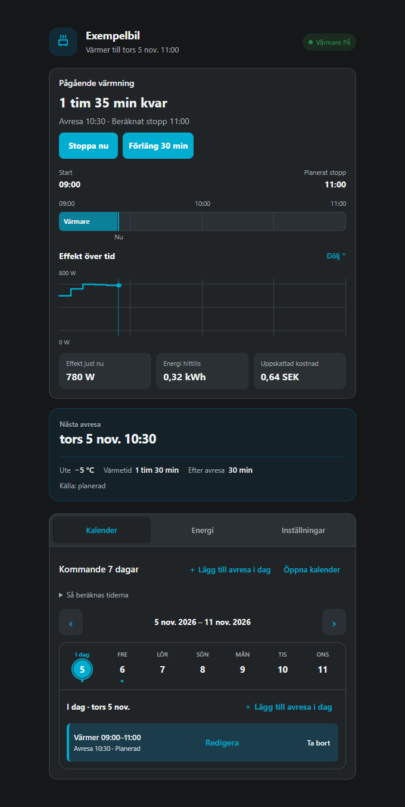

# Motorvärmare för Home Assistant

[English](../README.md) · Svenska

<!-- ha-marketplace:exclude-start -->
[](https://my.home-assistant.io/redirect/marketplace_repository/?owner=DanneG&repository=ha-motorvarmare&category=integration)
[](https://github.com/hacs/default)
[](https://github.com/DanneG/ha-motorvarmare/releases/latest)
[](https://analytics.home-assistant.io/custom_integrations.json#:~:text=%22motorvarmare%22)
[](https://github.com/DanneG/ha-motorvarmare/actions/workflows/validate.yml)
[](https://github.com/DanneG/ha-motorvarmare/blob/main/LICENSE)
<!-- ha-marketplace:exclude-end -->

Ange när du ska åka. Motorvärmare räknar ut när varje bils värmare ska starta utifrån utetemperaturen. Vid −5 °C och avresa 07.30 startar värmningen 06.00.

## Installation

<!-- ha-marketplace:exclude-start -->
- **Home Assistant 2026.11 eller senare** — Installera **Motorvärmare** under **Inställningar → Marknadsplatsen**.
- **Äldre versioner** — Sök efter **Motorvärmare** i HACS. [Öppna i HACS](https://my.home-assistant.io/redirect/hacs_repository/?owner=DanneG&repository=ha-motorvarmare&category=integration)
- Saknas integrationen i katalogen? Lägg till `https://github.com/DanneG/ha-motorvarmare` som anpassat förråd i kategorin **Integration**.

[](https://my.home-assistant.io/redirect/marketplace_repository/?owner=DanneG&repository=ha-motorvarmare&category=integration)
<!-- ha-marketplace:exclude-end -->

1. Starta om Home Assistant efter installation eller uppdatering.
2. Lägg till **Motorvärmare** under **Inställningar → Enheter och tjänster** en gång per bil. Välj bilens brytare och en utetemperatursensor (°C eller °F).
3. Ladda om kontrollpanelen. Lägg till det medföljande kortet **Motorvärmare** och välj bilens statussensor. För flera bilar finns **Motorvärmare – översikt**.

<details>
<summary>Manuell installation, YAML eller det gamla separata kortet</summary>

- **Manuell installation.** Kopiera hela mappen `custom_components/motorvarmare` till Home Assistants `custom_components` och följ stegen ovan.
- **Separat kort.** När Home Assistant hanterar resurserna ersätts HACS-kortets standardadress och `/local/ha-motorvarmare-card.js` automatiskt. När det inbyggda kortet fungerar kan du ta bort det gamla kortpaketet från HACS och eventuell egen resursadress för det.
- **Resurser i YAML.** Lägg till följande i din befintliga lista `lovelace.resources` och ersätt eventuell äldre Motorvärmare-post. Byt `VERSION` mot installerad integrationsversion efter varje uppdatering.

```yaml
- url: /motorvarmare/ha-motorvarmare-card.js?v=VERSION
  type: module
```

</details>

## Planera avresor

- **Från kortet.** Välj ett datum och lägg till en avresa. En ring markerar i dag. Den fyllda cirkeln visar vald dag. Kontrollera datum och klockslag på sparknappen.
- **Återkommande avresor.** Välj daglig, veckovis, månadsvis eller årlig upprepning med intervall och valfritt slutdatum. Du kan lägga till flera avresor per dag, ändra ett tillfälle eller hela serien och hoppa över nästa avresa. Om du ändrar seriens start eller upprepning rensas dess undantag.
- **Från Google Kalender.** Anslut Google Kalender till Home Assistant och välj kalendern i bilens inställningar. Ange exakta titlar (t.ex. `EKA JOBB`) eller ord och taggar (t.ex. `kontor, #bil1`). En träff räcker oavsett stora eller små bokstäver. Ord och taggar söks i titel och beskrivning. Händelsens starttid blir avresetid. Heldagshändelser hoppas över. [Anslut Google Kalender](https://www.home-assistant.io/integrations/google/)

## Värmetid

| Utetemperatur | Värmetid före avresa |
| --- | --- |
| Över +10 °C | Av |
| 0 till +10 °C | 1 tim |
| −5 °C | 1 tim 30 min |
| −10 °C | 2 tim |
| −20 °C eller kallare | 3 tim |

Under noll tillkommer 6 minuter per minusgrad, avrundat uppåt till hela minuter. En valfri timprognos ger uppskattade starttider framåt. Schemalagd värmning styrs av uppmätt temperatur. [M Sverige / Calix](https://msverige.se/allt-om-bilen/service-och-underhall/motorvarmare/)

- **Starta nu** använder samma värmetid. **Förläng 30 minuter** förlänger pågående värmning, upp till 4 timmar totalt.
- Schemalagd värmning kan fortsätta 30 minuter efter avresa om du väljer det i inställningarna. Värmaren stannar över +10 °C.

## Energi och larm

- **Valfri effektsensor.** Välj pluggens sensor i W eller kW för att se aktuell effekt och beräknad energi i kWh. Lägg till fast pris per kWh eller en prissensor för att se uppskattad kostnad.
- **Kabelpåminnelse.** Om nya effektvärden ligger under 10 W i 5 minuter efter start kan Home Assistant påminna dig att kontrollera kabeln. Du kan ändra gränsen och väntetiden. Kontrollen avslutas när effekten når gränsen. Mobilnotis är valfritt.
- **Kvällens kabeltest (av från början).** Välj en effektsensor och aktivera testet i bilens inställningar. Kör kl. 21.00 (valbar tid) eller använd **Testa värmarkabeln** på kortet eller i en rutin. Om morgondagens första avresa behöver värmning slår testet på uttaget och skickar stoppkommandot inom 10 sekunder. Testet använder timprognosen om den finns, annars utegivaren. Låg effekt ger högst en påminnelse per dag. Saknas färska mätvärden visas **Kunde inte avgöras**.
- **Historik.** Se start, stopp och gångtid för de senaste 1 000 körningarna per bil. Dags-, vecko- och månadssummor för energi räknas efter lokalt slutdatum. Mätluckor och värmningar över en periodgräns kan ge ofullständiga summor.

## Före obevakad användning

Prova start och stopp med bilen ansluten. Använd utrustning avsedd för belastningen och en separat maxtimer. Home Assistant behöver kontakt med brytaren för att kunna stänga av värmaren. Spara inställningarna mellan värmningarna eftersom omladdning avbryter en värmning som integrationen styr.

Bilens statussensor innehåller uppgifter om avresor. Ge den samma åtkomstskydd som kalendern.



[MIT-licens](../LICENSE)
